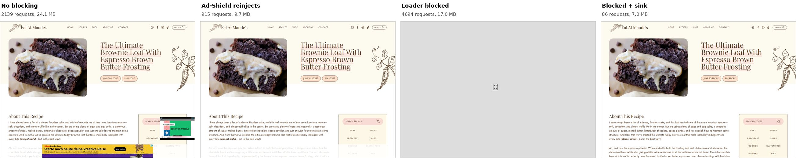

+++
title = "Measurements"
description = "Page traffic, ads and breakage with and without the sink on sites that use the Ad-Shield loader."
weight = 12
+++

# Measurements: traffic with and without the sink

Date: 2026-09-26. Three Raptive recipe blogs and Tom's Hardware, each loaded in four states:

| State | DNS | Ad-Shield loader hosts |
| --- | --- | --- |
| No blocking | public resolver | reachable |
| Ad-Shield reachable | filtering resolver | resolve publicly, as with a blocklist that has no Ad-Shield entries |
| Loader blocked | filtering resolver | refused, as with a blocklist that has them |
| Sink | filtering resolver | rewritten to the sink |

## Results

Ranges cover two runs; the loader-blocked state ran once. Download and upload are TLS bytes on the wire for one page view, scrolled to the end. Ad frames are rendered Google ad iframes at the end of the view.

| Site | State | Requests | Download MB | Upload MB | Ad frames | Error dialogs |
| --- | --- | --- | --- | --- | --- | --- |
| Pinch of Yum | No blocking | 3185–3544 | 24.5–25.4 | 7.6–8.5 | 6–12 | 0 |
| | Ad-Shield reachable | 1772–4824 | 9.2–18.5 | 5.0–21.0 | 10 | 0 |
| | Loader blocked | 6373 | 4.0 | 0.4 | 0 | 66 |
| | Sink | 113–114 | 2.2 | 0.1 | 0 | 0 |
| Eat at Maude's | No blocking | 2139–2504 | 24.1–31.8 | 5.1–6.2 | 4 | 0 |
| | Ad-Shield reachable | 915–1204 | 9.7–14.8 | 2.8–3.3 | 1–3 | 0 |
| | Loader blocked | 4694 | 17.0 | 0.6 | 0 | 53 |
| | Sink | 85–86 | 6.8–7.0 | 0.1 | 0 | 0 |
| Hot Thai Kitchen | No blocking | 4358–4805 | 262–304 | 9.6–12.7 | 18 | 0 |
| | Ad-Shield reachable | 3055–4411 | 24.5–32.8 | 6.1–10.2 | 14–16 | 0 |
| | Loader blocked | 2277 | 30.3 | 4.2 | 0 | 38 |
| | Sink | 71–82 | 2.0–2.8 | 0.2–0.3 | 0 | 0 |
| Tom's Hardware | No blocking | 2459 | 29.5 | 4.9 | 12 | 0 |
| | Ad-Shield reachable | 209 | 9.2 | 0.1 | 0 | 0 |
| | Loader blocked | 1073 | 9.9 | 0.2 | 0 | 6 |
| | Sink | 207 | 9.1 | 0.1 | 0 | 0 |

- DNS blocking alone does not remove the ads on the recipe blogs. With the loader reachable, Ad-Shield reinjects almost as many ads as without blocking, and routes them through numbered `html-load.com` subdomains that a blocklist does not cover. 96–99% of the upload in that state goes to Ad-Shield hosts.
- Blocking the loader without the sink breaks the page: stylesheets are removed, the error dialog appears and the page reloads until the tab is closed. On Pinch of Yum and Eat at Maude's the reload loop makes more requests than the page without any blocking.
- With the sink, the recipe blogs need 71–114 requests and 2–7 MB instead of 915–4824 requests and 9–33 MB with the loader reachable. Compared with no blocking, it saves about 17–300 MB per page view.
- Tom's Hardware requested the real loader but did not reinject ads in these runs, so the sink saves only the difference between the real loader and the stub.

## Savings

Each value compares a state with the sink, run by run. Percentages are the share of that state's traffic the sink avoids; the factor is how many times more the other state transfers.

| Site | Download, vs Ad-Shield reachable | Upload, vs Ad-Shield reachable | Requests, vs Ad-Shield reachable | Download, vs no blocking |
| --- | --- | --- | --- | --- |
| Pinch of Yum | 4.2–8.4× less (76–88% saved) | 63–268× less (98–99.6% saved) | 16–43× fewer | 11× less (91% saved) |
| Eat at Maude's | 1.4–2.2× less (28–54% saved) | 38–42× less (97% saved) | 11–14× fewer | 3.5–4.7× less (71–79% saved) |
| Hot Thai Kitchen | 8.9–17× less (89–94% saved) | 34× less (97% saved) | 43–54× fewer | 110–133× less (99% saved) |
| Tom's Hardware | no difference | no difference | no difference | 3.2× less (69% saved) |

## Where the savings come from

Download in MB by destination, from one run per state. First party is the site's own domain; Ad-Shield hosts are the loader domains and their numbered subdomains.

| Site | State | First party | Ad-Shield hosts | Other third parties |
| --- | --- | --- | --- | --- |
| Pinch of Yum | No blocking | 1.8 | 0 | 23.6 |
| | Ad-Shield reachable | 1.8 | 16.1 | 0.5 |
| | Loader blocked | 1.9 | 0.2 | 2.0 |
| | Sink | 1.8 | 0.0 | 0.4 |
| Eat at Maude's | No blocking | 5.2 | 0 | 26.6 |
| | Ad-Shield reachable | 5.2 | 7.8 | 1.7 |
| | Loader blocked | 10.3 | 0.1 | 6.5 |
| | Sink | 5.2 | 0.0 | 1.6 |
| Hot Thai Kitchen | No blocking | 0.9 | 0 | 302.9 |
| | Ad-Shield reachable | 0.9 | 21.7 | 1.9 |
| | Loader blocked | 1.0 | 0.1 | 29.2 |
| | Sink | 0.9 | 0.0 | 1.9 |
| Tom's Hardware | No blocking | 2.6 | 0 | 26.8 |
| | Ad-Shield reachable | 2.6 | 0.1 | 6.5 |
| | Loader blocked | 5.1 | 0.0 | 4.8 |
| | Sink | 2.6 | 0.0 | 6.5 |

- The site's own content is the same with and without the sink. Nothing the reader came for is removed.
- Against no blocking, the whole difference is third-party ad and tracking traffic that the DNS filter drops, mostly video ad CDNs such as `cdn.flashtalking.com` (up to 269 MB) and Google's `2mdn.net`. The filter saves this, not the sink.
- Against Ad-Shield reachable, the difference is the traffic on Ad-Shield hosts: the ad stack proxied through `*.html-load.com`, 1086–4281 requests and 7.8–21.7 MB down plus 2.7–20.9 MB up per view. The other third parties are nearly the same as with the sink. This saving is the sink's.
- Against loader blocked, the difference is the reload loop: the page and its embeds load again and again (2947 first-party requests instead of 48 on Pinch of Yum, 10.3 MB instead of 5.2 on Eat at Maude's, the Cloudflare challenge 28 MB on Hot Thai Kitchen), and every reload retries all fallback hosts. The sink ends the loop.

## Screenshots

Above the fold on Eat at Maude's in all four states. With the loader blocked, the error-report modal covers the page.

The first 9000 pixels of the Pinch of Yum recipe. Reinjected ads fill the sidebar and the article with the loader reachable; the sink leaves the article alone.

## Method

- Chrome for Testing 153 through Playwright in headless mode with a regular Chrome user agent, 1280 × 900 viewport, English locale, from a German residential connection. The default headless shell received almost no ads, so it was not used.
- A local CONNECT proxy chose the DNS answer per host for each state and counted bytes per host. The filtering resolver is the operator's AdGuard Home with its regular blocklists; the public resolver is `1.1.1.1`. QUIC was disabled so all traffic passed the proxy.
- Consent banners were accepted when shown; with filtering, some consent managers never loaded.
- Each view: load, 20 seconds idle, scroll to the end, 10 seconds idle, then viewport captures from top to bottom. A view took one to three minutes.
- Stitched screenshots are viewport captures placed at their scroll offsets, because ads outside the viewport do not render. Sticky ads therefore appear once per viewport.
- Ad auctions differ between runs, so treat the numbers as orders of magnitude.
